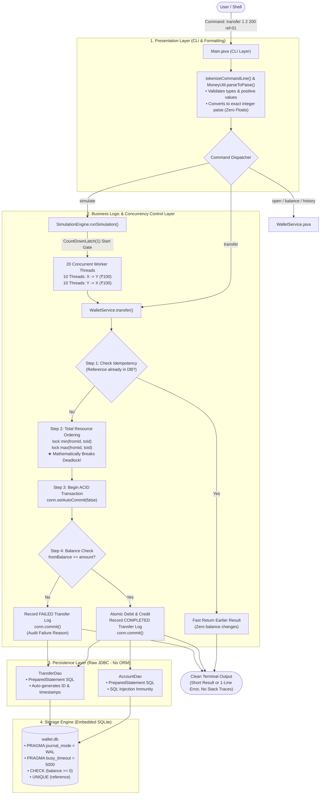

# Vayana Campus Programming Assessment — Problem B: Wallet Transfers

A high-performance, concurrency-safe, command-line wallet transfer system built in **Core Java 17+** backed by an embedded **SQLite** database using pure **JDBC (raw SQL)**.

---

## 🏛️ Application Architecture & End-to-End Flow Diagram



---

## 1. How to Build and Run the Program

### Prerequisites
* Java JDK 17 or higher (`java -version`)
* Maven (or use the provided `mvnw.cmd` on Windows)

### Build
To build the application and package the standalone executable JAR:
```bash
# Windows
.\mvnw.cmd package -DskipTests

# Or using standard maven
mvn package -DskipTests
```
This produces an uber JAR at: `target/wallet-transfers-1.0.0.jar`.

### Running Tests
To run all automated JUnit 5 tests (including the 20-thread concurrency simulation test):
```bash
.\mvnw.cmd test
```

### Running the Application
The application supports **both single-command runs** and an **interactive REPL shell**.

#### Option A: Convenient Runner Script
```bash
# Windows
.\wallet.bat open Alice 1000
.\wallet.bat balance 1
.\wallet.bat simulate

# Linux / macOS
chmod +x wallet
./wallet open Alice 1000
./wallet balance 1
./wallet simulate
```

#### Option B: Direct Java Invocation
```bash
# Interactive REPL mode:
java -jar target/wallet-transfers-1.0.0.jar

# Single command execution:
java -jar target/wallet-transfers-1.0.0.jar <command> [args...]
```

---

## 2. Commands & Example Runs

### 1. `open <name> <opening_balance>`
Creates an account and prints its ID. Money is stored internally as integer paise (₹1 = 100 paise).
```bash
$ .\wallet.bat open Alice 1000
Account created with ID: 1 (Owner: Alice, Balance: ₹1,000.00 (Rs. 1,000.00) [100,000 paise])

$ .\wallet.bat open Bob 500
Account created with ID: 2 (Owner: Bob, Balance: ₹500.00 (Rs. 500.00) [50,000 paise])
```

### 2. `balance <account>`
Prints the current balance of the specified account.
```bash
$ .\wallet.bat balance 1
Account 1 (Alice) Balance: ₹1,000.00 (Rs. 1,000.00) [100,000 paise]
```

### 3. `transfer <from> <to> <amount> <reference>`
Moves money atomically between accounts in one step. Enforces idempotency via the unique reference.
```bash
$ .\wallet.bat transfer 1 2 200 tx-ref-001
Transfer COMPLETED: Reference 'tx-ref-001' | ₹200.00 (Rs. 200.00) moved from Account 1 to Account 2

$ .\wallet.bat balance 1
Account 1 (Alice) Balance: ₹800.00 (Rs. 800.00) [80,000 paise]

$ .\wallet.bat balance 2
Account 2 (Bob) Balance: ₹700.00 (Rs. 700.00) [70,000 paise]
```

#### Idempotency Check (Duplicate Reference Replay):
If the same reference is used again, the system prints the earlier result and moves no money:
```bash
$ .\wallet.bat transfer 1 2 200 tx-ref-001
[Duplicate Reference: 'tx-ref-001'] Earlier Result: COMPLETED | Amount: ₹200.00 (Rs. 200.00) | From: 1 -> To: 2 | No money moved.
```

#### Insufficient Balance Handling:
Fails gracefully without crashing, logs the failed transaction with the reason:
```bash
$ .\wallet.bat transfer 1 2 5000 tx-ref-002
Transfer FAILED: Insufficient balance in account 1 (Reference: tx-ref-002)
```

### 4. `history <account> [--limit 10]`
Lists all incoming and outgoing transfers (newest first), including failed transfers and their reasons.
```bash
$ .\wallet.bat history 1
---------------------------------------------------------------------------------------------------------
ID    | TYPE   | FROM   | TO     | AMOUNT          | REFERENCE        | STATUS     | REASON               | DATE
---------------------------------------------------------------------------------------------------------
2     | OUT    | 1      | 2      | ₹5,000.00       | tx-ref-002       | FAILED     | Insufficient balance | 2026-10-17 09:30:24
1     | OUT    | 1      | 2      | ₹200.00         | tx-ref-001       | COMPLETED  | -                    | 2026-10-17 09:30:06
---------------------------------------------------------------------------------------------------------
```

### 5. `simulate`
Initializes accounts X and Y with ₹1,000 each. Launches 20 concurrent threads simultaneously (10 threads transfer ₹100 from X→Y, and 10 threads transfer ₹100 from Y→X).
```bash
$ .\wallet.bat simulate
Starting 20-thread concurrency simulation...
- Accounts X and Y initialized with ₹1,000.00 each (Total = ₹2,000.00)
- Running 10 threads: X -> Y (₹100.00)
- Running 10 threads: Y -> X (₹100.00)
Simulating simultaneous execution...
================ SIMULATION RESULTS ================
Account X (ID: 3): Final Balance = ₹1,000.00 (Rs. 1,000.00) [100,000 paise]
Account Y (ID: 4): Final Balance = ₹1,000.00 (Rs. 1,000.00) [100,000 paise]
Total Balance: ₹2,000.00 (Rs. 2,000.00) [200,000 paise]
Transfers Succeeded: 20
Transfers Failed: 0
Rule Check (X + Y == ₹2,000.00 & Balances >= 0): PASSED (No money lost or created, zero deadlocks)
Total Duration: 190 ms
===================================================
```

---

## 3. Database Schema

The database lives in `wallet.db` (SQLite) and is created automatically on first run using raw SQL:

```sql
CREATE TABLE IF NOT EXISTS accounts (
    id INTEGER PRIMARY KEY AUTOINCREMENT,
    owner_name TEXT NOT NULL,
    balance INTEGER NOT NULL CHECK (balance >= 0),
    created_at DATETIME DEFAULT (datetime('now', 'localtime'))
);

CREATE TABLE IF NOT EXISTS transfers (
    id INTEGER PRIMARY KEY AUTOINCREMENT,
    from_id INTEGER NOT NULL,
    to_id INTEGER NOT NULL,
    amount INTEGER NOT NULL CHECK (amount > 0),
    reference TEXT UNIQUE NOT NULL,
    status TEXT NOT NULL CHECK (status IN ('COMPLETED', 'FAILED')),
    reason TEXT,
    created_at DATETIME DEFAULT (datetime('now', 'localtime')),
    FOREIGN KEY (from_id) REFERENCES accounts(id),
    FOREIGN KEY (to_id) REFERENCES accounts(id)
);

CREATE INDEX IF NOT EXISTS idx_transfers_from_id ON transfers(from_id);
CREATE INDEX IF NOT EXISTS idx_transfers_to_id ON transfers(to_id);
CREATE INDEX IF NOT EXISTS idx_transfers_ref ON transfers(reference);
```

### Schema Guarantees:
* **Integer Arithmetic**: `balance` and `amount` are integer types representing paise to eliminate IEEE-754 floating-point inaccuracies.
* **Non-negative Invariant**: `CHECK (balance >= 0)` enforces at the storage engine level that accounts can never overdraw.
* **Idempotency**: `reference TEXT UNIQUE NOT NULL` ensures no transaction reference can ever be duplicated.

---

## 4. How the Threading Exercise Was Kept Correct (5–10 Lines)

1. **Deadlock Prevention via Total Resource Ordering**: When transferring between two accounts, locks are always acquired in ascending account ID order (`Math.min(fromId, toId)` followed by `Math.max(fromId, toId)`). This mathematically breaks Coffman's circular wait condition when transfers $X \rightarrow Y$ and $Y \rightarrow X$ trigger at the exact same moment.
2. **ACID Transactions**: Each transfer runs under `connection.setAutoCommit(false)`, updating both debit and credit alongside transfer logging before a single `commit()` (or `rollback()` upon any failure).
3. **SQLite WAL Mode & Busy Timeout**: Enabled `PRAGMA journal_mode = WAL` and `PRAGMA busy_timeout = 5000` to support concurrent reads and safe queued writes.
4. **Synchronized Write Serialization**: Write transactions are synchronized at the service layer to prevent SQLite file-lock conflicts (`SQLITE_BUSY`) under high-density thread concurrency.
5. **Simultaneous Unleash with CountDownLatch**: The simulation uses a `startGate` `CountDownLatch(1)` so all 20 worker threads start executing simultaneously, ensuring real-world race conditions are accurately tested.

---

## 5. Automated Tests

The test suite in `WalletServiceTest.java` contains 6 comprehensive automated tests:
1. `testCreateAccountAndCheckBalance()`: Verifies account creation and exact initial balance retrieval in paise.
2. `testSuccessfulTransfer()`: Verifies atomic balance deduction and addition, ensuring balance conservation ($A + B$ constant).
3. `testInsufficientFundsFailsGracefully()`: Verifies that overdrawing fails gracefully, records a `FAILED` transfer audit record, and leaves balances untouched.
4. `testIdempotencyWithSameReference()`: Verifies that retrying with the same reference moves no money and replays the original result.
5. `testValidationRules()`: Verifies that self-transfers (`from == to`) and non-positive amounts (`amount <= 0`) are rejected immediately.
6. `testConcurrentSimulateNoMoneyLostAndNoDeadlock()`: Runs the 20-thread simulation 3 times consecutively, asserting zero deadlocks, zero negative balances, and exact ₹2,000 balance conservation.

---

## 6. What I Would Do With Another Day

1. **Connection Pooling & Read-Write Segregation**: Integrate a lightweight connection pool (e.g., HikariCP) configured with read-only replicas to maximize parallel read throughput on `balance` and `history` queries.
2. **Distributed Architecture / PostgreSQL Migration**: Switch to PostgreSQL using row-level locking (`SELECT id, balance FROM accounts WHERE id IN (?, ?) ORDER BY id FOR UPDATE`) to allow concurrent writes across independent account pairs.
3. **Audit Log Export & Reconciliation Tool**: Add a CLI command `reconcile` that sums all historical completed transfers against all current balances to verify global ledger consistency mathematically.
4. **REST API & Web Dashboard**: Expose a clean, lightweight REST/HTTP layer (using Java 17 `com.sun.net.httpserver` or a microframework) with a real-time reactive dashboard visualizing transfer streams and thread activities.
